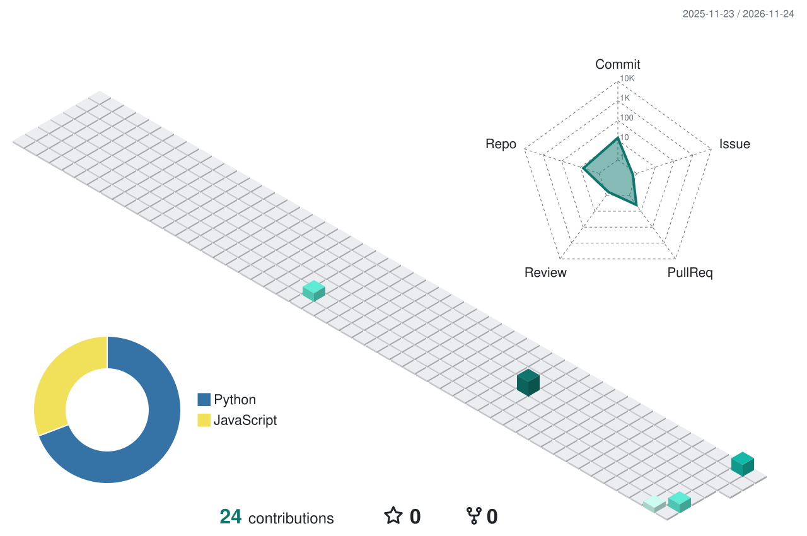

<picture>
  <source media="(prefers-color-scheme: dark)" srcset="assets/header-dark.svg">
  
</picture>

KTO Karatay Üniversitesi'nde Bilgisayar Mühendisliği okuyorum; full-stack geliştirme ile yapay zekânın kesiştiği yerde ürün geliştiriyorum. **FastAPI ve Next.js** ile çok kiracılı SaaS platformları kuruyor, **PostgreSQL** tarafında satır seviyesinde güvenlikle (RLS) verileri izole ediyor; **LLM ve RAG** ile kodu okuyan, yorumlayan ve karar veren sistemler tasarlıyorum. Restoranlar için QR menü platformundan doğrulanmış öğrencilere özel kampüs topluluğuna, NASA uydu verisiyle iklim trendi analizinden pull request inceleyen bir GitHub App'e kadar uçtan uca projeler geliştiriyorum.

### ÖNE ÇIKAN PROJE

**PR Review Assistant**, bitirme projem: GitHub'da açılan pull request'leri yapay zekâ ile otomatik inceleyen bir GitHub App. *Yapay Zeka Destekli Kod İnceleme Asistanı: GitHub Pull Request Analizi için RAG Tabanlı Bir Yaklaşım.*

- **Akış:** PR açılınca webhook imzası doğrulanır, istek hemen `200` ile yanıtlanır ve inceleme arka planda başlar; GitHub App olarak token alınıp diff satır numaralarıyla çekilir.
- **LLM katmanı:** Sağlayıcıdan bağımsız LLM arayüzü, Gemini ile JSON şemalı yapılandırılmış çıktı, yoğunlukta sırayla denenen yedek modeller ve zaman aşımı yönetimi.
- **İnceleme motoru:** Bulgular **hata riski, güvenlik, performans ve okunabilirlik** kategorilerinde sınıflanır, önem sırasıyla PR'a yorum olarak yazılır.
- **Sırada:** tree-sitter ile kod parçalama, satıra bağlı yorumlar, pgvector üzerinde RAG ve doğrulama katmanı; ardından Ollama ile yerel model, web paneli, AWS kurulumu ve karşılaştırmalı deneyler.

### PROJELER

küçük projeler: <a href="https://github.com/ekremagzl/weather-app">weather-app</a> · <a href="https://github.com/ekremagzl/personel-yonetim">personel-yonetim</a> · <a href="https://github.com/ekremagzl/to-do-list">to-do-list</a> · <a href="https://github.com/ekremagzl/qr-generator">qr-generator</a>

### ŞU AN

Bitirme projemin ikinci iş paketindeyim: tree-sitter ile kodu anlamlı parçalara bölüyor, pgvector üzerinde RAG kurup bulguları satır satır doğrulayan bir katman ekliyorum. Bir yandan da Kampüsüm'ü KTO Karatay'da kapalı betaya hazırlıyor, Menüm'ün çok kiracılı altyapısını ve yayın tarafını (Docker, Caddy) olgunlaştırıyorum.

### BİLDİKLERİM

<b>dil</b> 
     
<b>backend</b> 
          
<b>frontend</b> 
        
<b>veri tabanı</b> 
       
<b>ai · veri</b> 
        
<b>test · devops</b> 
        

### AKTİVİTE

<picture>
  <source media="(prefers-color-scheme: dark)" srcset="profile-3d-contrib/ekremagzl-dark.svg">
  
</picture>

<picture>
  <source media="(prefers-color-scheme: dark)" srcset="https://raw.githubusercontent.com/ekremagzl/ekremagzl/output/snake-dark.svg">
  
</picture>

### İLETİŞİM

<!-- LinkedIn ve e-posta: aşağıdaki satırları kendi bilgilerinle doldurup yorumdan çıkar.

-->
